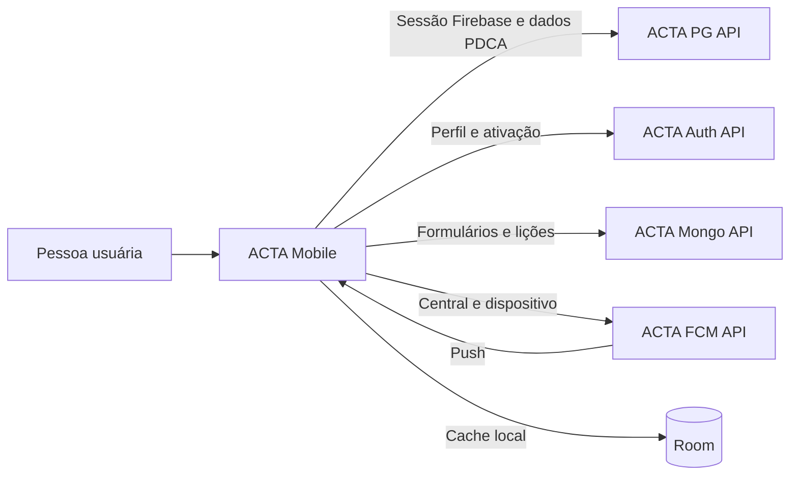

# 📱 ACTA Mobile

Aplicativo Android do ACTA para acompanhar ciclos PDCA, executar tarefas atribuídas e participar do aprendizado contínuo da equipe.

## 📌 Visão geral

O `acta-mobile` é o canal de consulta e participação de colaboradores no ACTA. Após autenticar uma conta Firebase vinculada a um usuário ACTA, a pessoa pode acompanhar seus ciclos e tarefas, consultar informações do PDCA, registrar lições aprendidas e acessar a central de notificações.

O app consome os serviços do ACTA e mantém dados selecionados em banco local para reapresentar informações já carregadas. As regras de autorização, persistência compartilhada e transições de negócio pertencem às APIs. O aplicativo não oferece toda a gestão disponível na plataforma web.

## ✨ Funcionalidades

| Domínio | Capacidades |
| --- | --- |
| Acesso e perfil | Login por e-mail e senha com Firebase, ativação manual de convite, recuperação de senha, consulta de perfil, atualização de foto e preferência local de tema. |
| Ciclos PDCA | Consulta de ciclos vinculados à pessoa, resumo do ciclo e navegação pelas etapas Plan, Do, Check e Act conforme os dados retornados pelas APIs. |
| Execução | Consulta de planos de ação, metas, 5W2H e tarefas; conclusão de tarefas quando a transição é aceita pelo servidor. |
| Verificação e aprendizado | Consulta de resultados e efeitos secundários; consulta e registro de lições aprendidas associadas a um ciclo. |
| Formulários | Consulta de formulários e envio de respostas disponíveis para a sessão autenticada. |
| Notificações | Central com contador, atualização, leitura individual ou em lote, registro e revogação de dispositivo para push e navegação por destinos suportados. |
| Persistência local | Cache Room de dados selecionados para reapresentação. Não há fila de escrita offline nem garantia de sincronização de alterações sem rede. |

O aplicativo não implementa a gestão integral de ciclos, planos, metas, formulários, treinamentos, dashboards ou relatórios da plataforma web. A disponibilidade de cada recurso também depende das permissões da sessão e do ambiente das APIs.

## 🛠️ Tecnologias

| Tecnologia | Uso |
| --- | --- |
| Android SDK 36 | Compilação e alvo do aplicativo; `minSdk` 30. |
| Java 11 | Compatibilidade de fonte e bytecode configurada no módulo Android. |
| Gradle 9.4.1 | Build por Gradle Wrapper. |
| Android Gradle Plugin 9.0.0 | Build do aplicativo Android. |
| Firebase Authentication | Autenticação e obtenção de token para chamadas protegidas. |
| Firebase Cloud Messaging / Installations | Recebimento de push e identificação da instalação. |
| Retrofit 2.11.0 / OkHttp 4.12.0 | Chamadas HTTP às APIs. |
| Room 2.6.1 | Cache local SQLite. |
| Google Maps SDK | Mapa e localização conforme permissões concedidas. |
| Cloudinary Android 3.1.2 | Envio da imagem de perfil. |

As demais bibliotecas e versões estão declaradas em [`app/build.gradle.kts`](app/build.gradle.kts) e [`gradle/libs.versions.toml`](gradle/libs.versions.toml).

## ✅ Pré-requisitos e configuração

- Android Studio compatível com Android Gradle Plugin 9.0.0, JDK 17 ou superior e Android SDK 36.
- Acesso aos ambientes de `acta-pg-api`, `acta-auth-api`, `acta-mongo-api` e `acta-fcm-api` usados pelo build.
- Configuração Firebase do aplicativo em `app/google-services.json`, obtida para o projeto Firebase correto. O arquivo é ignorado pelo Git.
- Chaves e URLs locais configuradas em `local.properties`, também ignorado pelo Git.

Adicione as propriedades necessárias ao `local.properties` na raiz do projeto. Use URLs fornecidas pelo responsável pelo ambiente; não copie hosts temporários ou credenciais para o repositório.

```properties
PG_API_URL=<URL_BASE_PG>/api/v1/
AUTH_API_URL=<URL_BASE_AUTH>/api/v1/
MONGO_API_URL=<URL_BASE_MONGO>/api/v1/
FCM_API_BASE_URL=<URL_BASE_FCM>/
CHATBOT_API_URL=<URL_BASE_CHATBOT>/
MAPS_API_KEY=<CHAVE_MAPS>
CLOUDINARY_CLOUD_NAME=<CLOUD_NAME>
CLOUDINARY_API_KEY=<API_KEY>
CLOUDINARY_API_SECRET=<API_SECRET>
```

As URLs são lidas pelo Gradle a partir de `local.properties`. PG, Auth, Mongo e FCM possuem clientes HTTP no app; Chatbot também tem cliente configurado, mas sua disponibilidade depende da URL e do contrato do serviço no ambiente. As propriedades de Cloudinary e Maps são incorporadas ao `BuildConfig` ou ao Manifest durante o build. Não trate credenciais incluídas em um aplicativo distribuído como segredos protegidos; use apenas chaves apropriadas para cliente e políticas restritivas nos serviços.

`AUTH_API_URL` é usada para consultar o perfil (`GET me`) e ativar convites (`POST auth/ativar`). As chamadas de ciclos, tarefas, usuários, colaboradores e outros dados relacionais continuam usando `PG_API_URL`.

## 🚀 Execução local

Abra o projeto no Android Studio, configure o Firebase e as propriedades locais e execute a configuração `app` em um emulador ou dispositivo com Android 11 (API 30) ou superior.

Também é possível compilar pelo terminal:

```powershell
./gradlew.bat assembleDebug
```

```bash
./gradlew assembleDebug
```

O APK de debug é gerado em `app/build/outputs/apk/debug/`. Para instalar com um dispositivo conectado via ADB:

```bash
adb install -r app/build/outputs/apk/debug/app-debug.apk
```

O aplicativo requer conexão de rede para consultar as APIs. O uso de localização, microfone, notificações e seleção/captura de imagem depende das permissões do Android e dos fluxos correspondentes.

## 🔌 Integrações e permissões

| Integração | Uso no aplicativo |
| --- | --- |
| Firebase Authentication | Login, sessão e token Bearer para APIs. |
| ACTA PG API | Perfil, usuários, ciclos, planos de ação, metas, tarefas e verificações. |
| ACTA Auth API | Consulta de perfil e ativação de convite conforme configuração atual. |
| ACTA Mongo API | Formulários, respostas e lições aprendidas. |
| ACTA FCM API | Central de notificações e registro/revogação de instalação. |
| Cloudinary | Upload da foto de perfil e obtenção de URL para salvar no perfil. |
| Google Maps / localização Android | Recursos de mapa; o app declara permissões de localização fina e aproximada. |

O Manifest declara acesso à internet, notificações, gravação de áudio e localização. O sistema pode solicitar notificações em tempo de execução; negar essa permissão não substitui nem desativa a consulta à central dentro do app.

## 🏗️ Arquitetura e estrutura



```text
app/src/main/java/br/com/acta/
├── Api/          # contratos Retrofit
├── Auth/         # sessão Firebase e autenticação HTTP
├── Client/       # clientes Retrofit por serviço
├── DAO/          # Room, entidades e consultas locais
├── Model/        # modelos e enums usados pelas telas e APIs
├── Services/     # coordenação de chamadas e serviços do app
├── Adapter/      # adapters de listas
└── *Activity.java / *Fragment.java  # telas e fluxos

app/src/main/res/ # layouts, navegação, strings, temas e recursos
app/src/test/     # testes locais unitários
app/src/androidTest/ # testes instrumentados
.github/workflows/validacao.yml # testes, lint e APK de debug
```

## 🧪 Validação e entrega

O workflow [Validação Android](.github/workflows/validacao.yml) roda em pull requests e pushes para `main`. Ele configura JDK 17 e Android SDK 36, exige o secret `GOOGLE_SERVICES_JSON`, executa testes unitários, Android Lint e build de debug, e publica o APK como artefato da execução.

Os comandos equivalentes para validação local são:

```bash
./gradlew testDebugUnitTest
./gradlew lintDebug
./gradlew assembleDebug
```

A configuração do workflow não comprova que a execução remota passou nem que o aplicativo foi validado contra serviços publicados ou em dispositivo real. O app mantém cache local, mas não oferece escrita offline com sincronização posterior.

## 🤝 Links e autoria

- [Repositório](https://github.com/AppActa/acta-mobile) · [Licença MIT](LICENSE) · `acta.institutojef@gmail.com`
- Integrações: [ACTA PG API](https://github.com/AppActa/acta-pg-api), [ACTA Mongo API](https://github.com/AppActa/acta-mongo-api) e [ACTA FCM API](https://github.com/AppActa/acta-fcm-api).
- Contribuições: use *issues* e *pull requests*; há um [PULL_REQUEST_TEMPLATE.md](PULL_REQUEST_TEMPLATE.md).